# 🏦 Bank Management System (C++ Console Application)

Welcome to the **Bank Management System** repository! This is a comprehensive, feature-rich console application built entirely in C++ using **Object-Oriented Programming (OOP)**, **Data Structures**, and **Clean Architecture** concepts.

---

## 🎯 About The Project & Learning Journey
This project is the culmination of my foundational learning journey in computer science and software development. It was built after completing the first 13 core courses from the **ProgrammingAdvices Roadmap** (by **Dr. Mohammed Abu-Hadhoud**), which covers fundamental programming concepts, advanced algorithms, object-oriented design, and data structures.

---

## 📚 Course Foundations Applied (Courses 01 - 13)
- **Programming Foundations (C++):** Memory management, control structures, and standard I/O.
- **Algorithms & Problem Solving (Levels 1 - 5):** Designing efficient algorithms, array manipulation, bitwise operations, and data validation.
- **Object-Oriented Programming (Levels 1 & 2):** Classes, Inheritance, Polymorphism, Encapsulation, Abstraction, and File Management.
- **Data Structures (Level 1):** Linked Lists, Stacks, Queues, and dynamic memory allocation.

---

## 📜 Course Certificates (Levels 5 - 13)

| Course Level | Certificate Preview | Official Document |
| :--- | :---: | :---: |
| **Level 5:** Algorithms & Problem Solving Level 2 |  | [View PDF](./certificates/level_5.pdf) |
| **Level 7:** Algorithms & Problem Solving Level 3 |  | [View PDF](./certificates/level_7.pdf) |
| **Level 8:** Algorithms & Problem Solving Level 4 |  | [View PDF](./certificates/level_8.pdf) |
| **Level 9:** Foundations Level 2 |  | [View PDF](./certificates/level_9.pdf) |
| **Level 10:** OOP Concepts |  | [View PDF](./certificates/level_10.pdf) |
| **Level 11:** OOP Applications |  | [View PDF](./certificates/level_11.pdf) |
| **Level 12:** Data Structures Level 1 |  | [View PDF](./certificates/level_12.pdf) |
| **Level 13:** Algorithms & Problem Solving Level 5 |  | [View PDF](./certificates/level_13.pdf) |

---

## 🚀 Key Features

### 🔐 1. Authentication & Role-Based Access Control (RBAC)
- **User Login:** Secure authentication with username and password verification.
- **Bitwise Permissions System:** Flexible permission flags granted per user to restrict or allow access to specific system features.
- **Access Guard Screen:** Rejects unauthorized feature execution with clear visual feedback.

### 💼 2. Client Management (CRUD Operations)
- **View Clients List:** Formatted tabular display of client accounts and balance details.
- **Add New Client:** Interactive prompts with uniqueness validation for Account Numbers.
- **Update / Delete Client:** Modify client records or remove them safely with confirmation checks.
- **Find Client:** Instant client lookup by account number.

### 💸 3. Financial Transactions & Validations
- **Deposit & Withdraw:** Secure balance adjustments with built-in validation (e.g., handling insufficient balance scenarios).
- **Account Transfer:** Transfer money directly between two accounts with real-time balance updates for both parties.
- **Transfer Audit Logs:** Automatically logs every transfer operation with timestamp, source account, destination account, transferred amount, and executing user.

### 💱 4. Multi-Currency Exchange Engine
- **Currencies List:** Displays exchange rates for over 200 world currencies relative to USD.
- **Currency Lookup:** Search currencies by Country Name or Currency Code.
- **Currency Exchange Calculator:** Real-time conversion calculation between any two currencies using base USD exchange rates.

---

## 📸 Application Screenshots

### 1. Authentication & Main Menu
| Login Screen | Main Menu Screen |
| :---: | :---: |
|  | 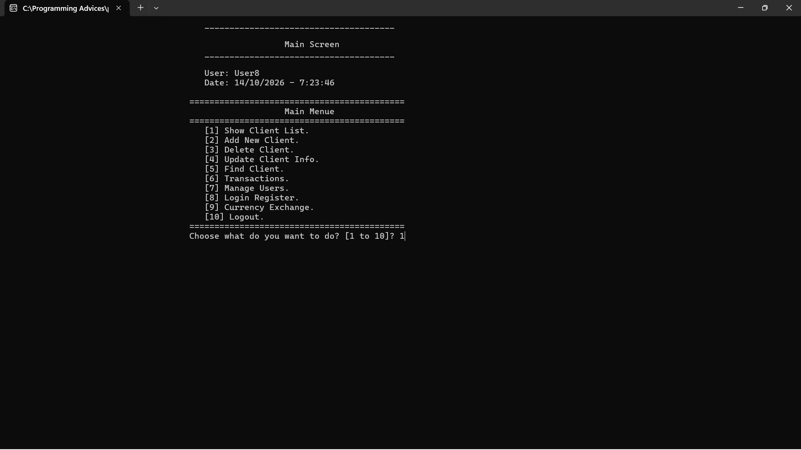 |

### 2. Client Management (CRUD)
| Client List | Add New Client |
| :---: | :---: |
|  | 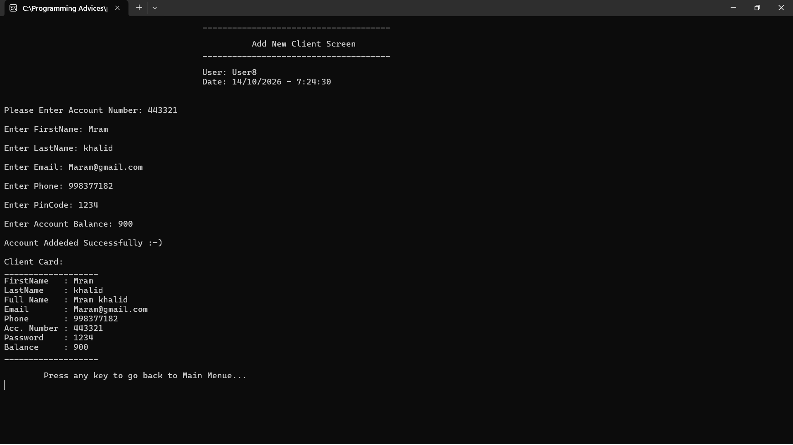 |

| Update Client Details | Delete Client Confirmation |
| :---: | :---: |
| 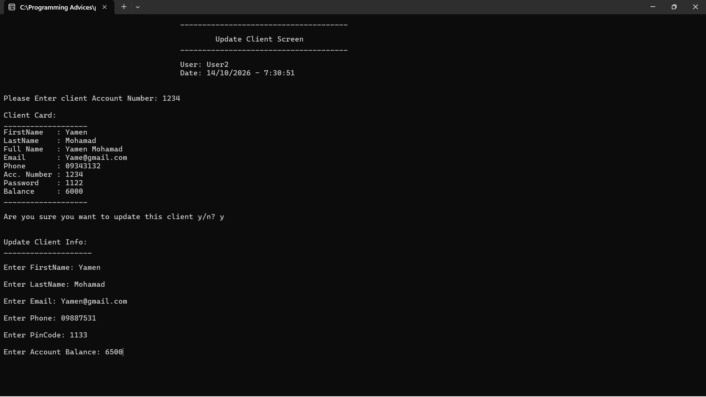 | 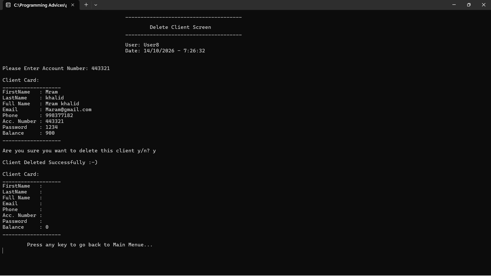 |

### 3. Financial Transactions & Transfer Audit Logs
| Transfer Money Screen | Transfer Audit Logs Screen |
| :---: | :---: |
| 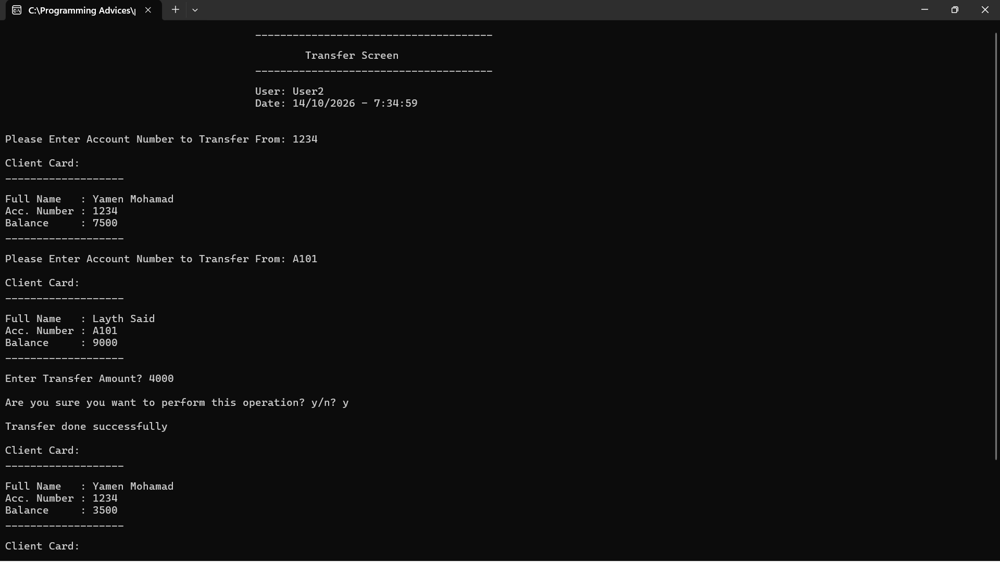 | 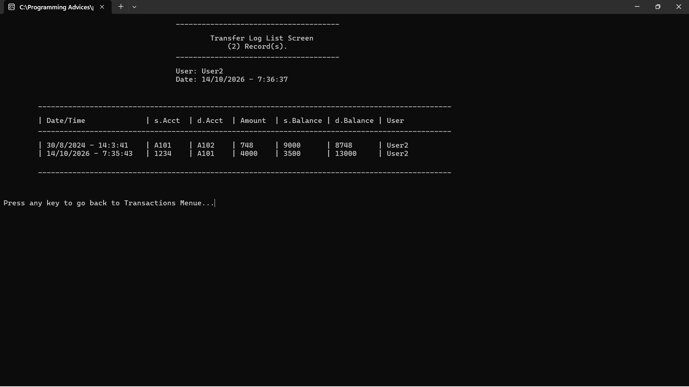 |

| Deposit Operation | Access Denied Guard |
| :---: | :---: |
| 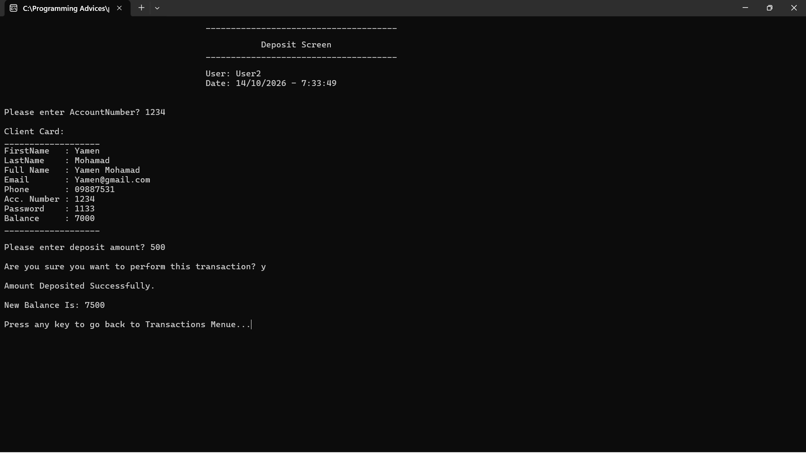 | 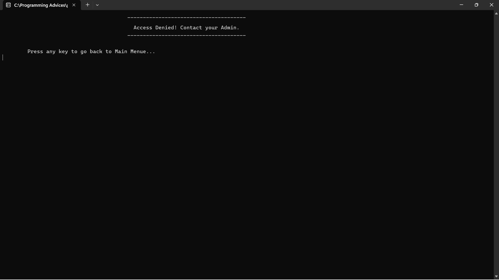 |

### 4. Currency Exchange Engine
| Currencies List | Find Currency | Currency Calculator |
| :---: | :---: | :---: |
| 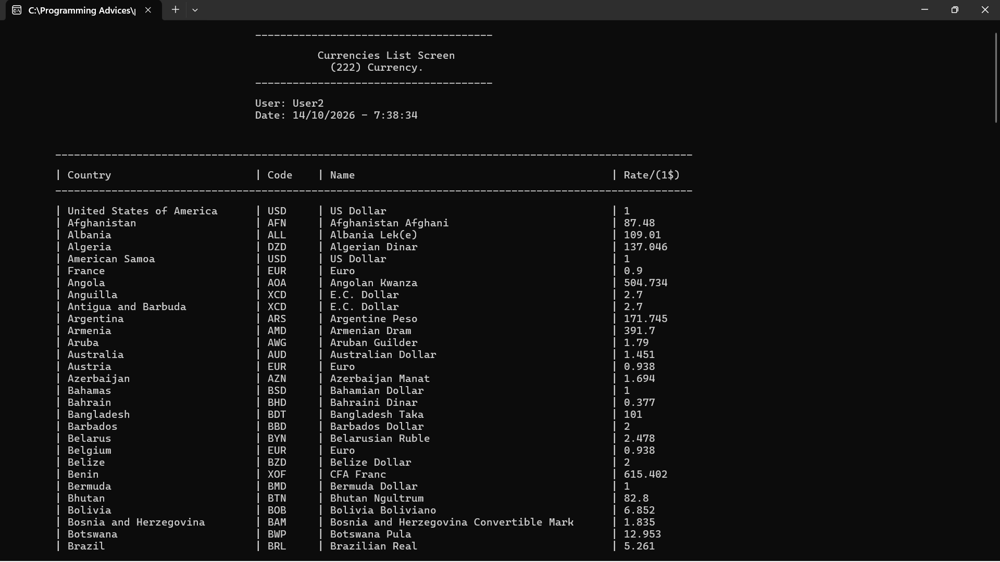 | 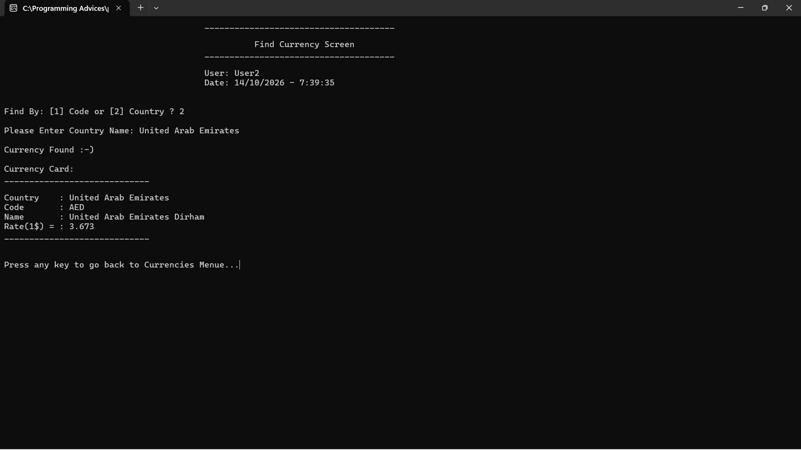 | 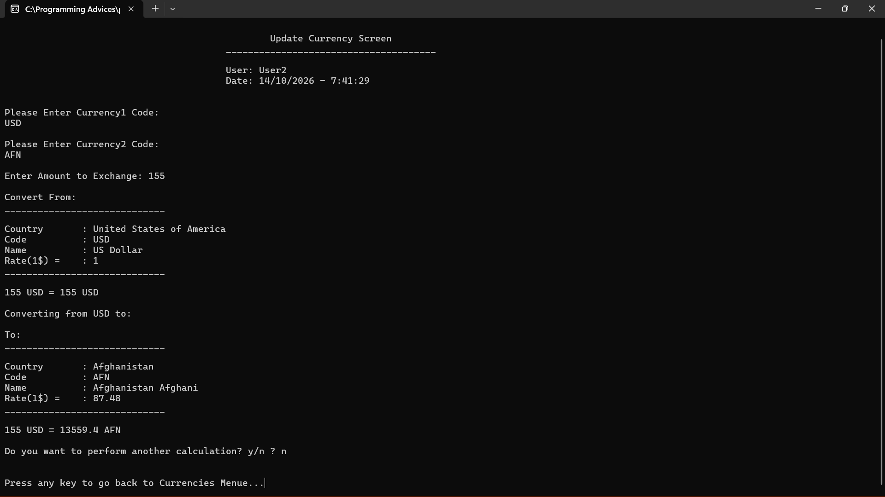 |

---

## 🛠️ Tech Stack & Concepts
- **Language:** C++
- **Paradigm:** Object-Oriented Programming (OOP)
- **Data Persistence:** File I/O (Storing/Retrieving client, user, and currency records)
- **Architecture:** Tiered Architecture (UI Screens, Business Layer, Data Access Layer)

---

## 👤 Author
Developed with passion as part of my continuous learning journey towards becoming a Full-Stack / Backend Developer!
- **Roadmap:** [ProgrammingAdvices.com](https://programmingadvices.com/) (Dr. Mohammed Abu-Hadhoud)
